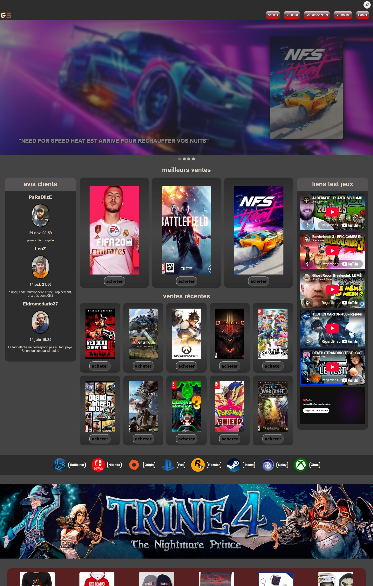
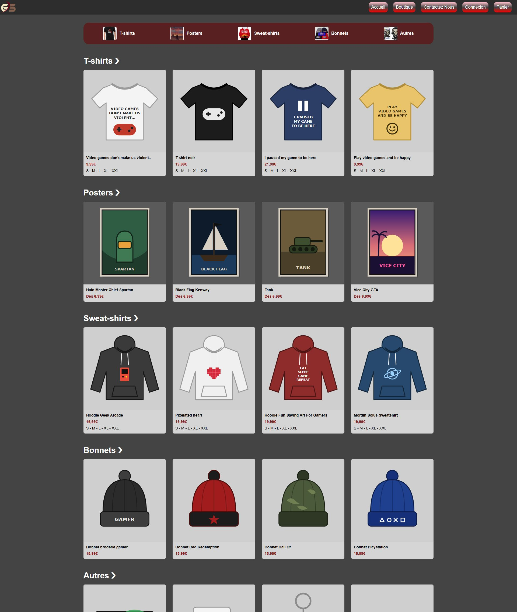
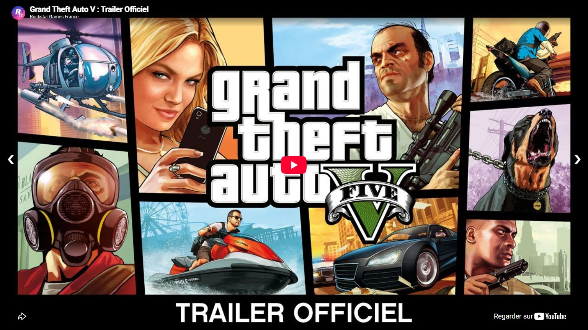
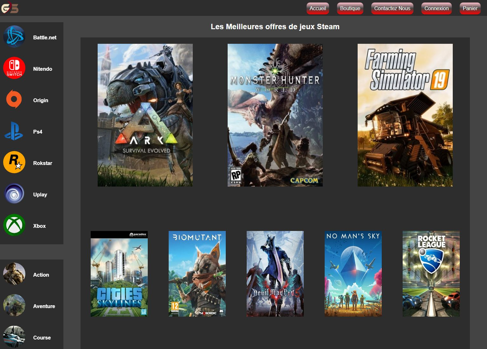
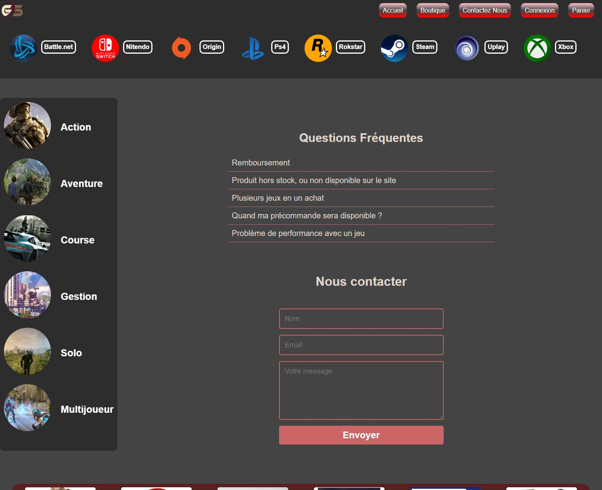
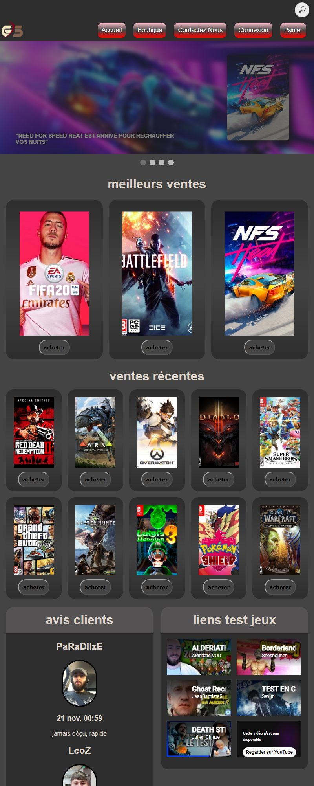

# GeStore

Site vitrine de vente de jeux vidéo dématérialisés, réalisé en groupe de 4 en première année de développement (2019). C'est notre tout premier projet web.

L'objectif était de reproduire le site [Instant Gaming](https://www.instant-gaming.com/) tel qu'il existait en 2019, en l'améliorant à notre façon. Le site est entièrement statique : HTML et CSS, avec très peu de JavaScript. Il n'y a ni serveur ni base de données, donc aucun achat réel n'est possible.



## Sommaire

- [Aperçu des pages](#aperçu-des-pages)
- [Fonctionnalités](#fonctionnalités)
- [Lancer le site](#lancer-le-site)
- [Organisation du projet](#organisation-du-projet)
- [Technologies](#technologies)
- [Limites connues](#limites-connues)
- [Crédits](#crédits)

## Aperçu des pages

### Boutique

Les produits dérivés (t-shirts, posters, sweat-shirts, bonnets, goodies) sont rangés par rayon dans une grille qui s'adapte à la largeur de l'écran.



### Fiche d'un jeu

Chaque jeu a sa page : bande-annonce et captures en diaporama, prix, description, configuration requise et avis.



### Catalogue par plateforme ou par genre



### Contact et FAQ



### Sur un écran étroit

La page d'accueil se réorganise quand la fenêtre rétrécit : les jeux passent en premier, les avis et les vidéos se placent en dessous.



## Fonctionnalités

- **Accueil** : diaporama automatique des sorties du moment, meilleures ventes, ventes récentes, avis clients et tests vidéo.
- **Catalogue** : 8 plateformes (Battle.net, Nintendo, Origin, PS4, Rockstar, Steam, Uplay, Xbox) et 6 genres (action, aventure, course, gestion, multijoueur, solo).
- **Fiches jeux** : 22 jeux détaillés.
- **Boutique** de produits dérivés.
- **Panier**, paiement et page de validation, simulés côté navigateur.
- **Connexion / inscription** (formulaires uniquement, sans compte réel).
- **Contact** avec une FAQ dépliable.
- **Bandeau cookies** affiché à la première visite.

## Lancer le site

Aucune installation n'est nécessaire.

```bash
git clone https://github.com/Git-Sathys/GeStore.git
cd GeStore
```

Ouvrez ensuite `index.html` dans un navigateur.

Les vidéos YouTube intégrées refusent de se lire quand la page est ouverte directement depuis le disque (`file://`). Pour les voir, servez le dossier avec un petit serveur local, par exemple :

```bash
python -m http.server 8000
```

puis rendez-vous sur <http://localhost:8000>.

## Organisation du projet

```
GeStore/
├── index.html            Page d'accueil
├── pages/
│   ├── boutique.html     Boutique de produits dérivés
│   ├── panier.html       Panier
│   ├── paiment.html      Paiement
│   ├── validation.html   Confirmation de commande
│   ├── connexion.html    Connexion
│   ├── inscription.html  Inscription
│   ├── contact.html      Contact et FAQ
│   ├── plateformes/      Une page par plateforme (steam.html, ps4.html…)
│   ├── genres/           Une page par genre (action.html, solo.html…)
│   └── jeux/             Une page par jeu (gta5.html, fifa20.html…)
├── css/
│   ├── style.css         Accueil
│   ├── boutique.css      Boutique
│   ├── jeux/             Fiches jeux
│   ├── plateformes/      Pages plateformes
│   └── genres/           Pages genres
├── js/                   Diaporamas, FAQ, panier, bandeau cookies
├── images/               Jaquettes, captures, logos, visuels de la boutique
└── docs/screenshots/     Captures utilisées dans ce README
```

## Technologies

- HTML5
- CSS3 (flexbox et grid)
- JavaScript, avec jQuery chargé depuis un CDN sur les pages panier et paiement

## Limites connues

C'est un projet d'apprentissage, et certaines parties sont restées incomplètes :

- Le panier, le paiement, la connexion et l'inscription ne sont reliés à aucun serveur.
- La recherche de la page d'accueil est décorative.
- Les liens vers les réseaux sociaux ne mènent nulle part.
- Seules l'accueil et la boutique s'adaptent à toutes les largeurs d'écran. Les autres pages ont été pensées pour un écran d'ordinateur.
- Certaines pages du catalogue pointent vers des fiches de jeux qui n'ont jamais été écrites (Far Cry 5, Rocket League, Minecraft…).

## Crédits

Projet scolaire sans but commercial. Les jaquettes, captures d'écran, logos et noms de jeux appartiennent à leurs éditeurs respectifs. Les illustrations des produits de la boutique (`images/Boutique/produits/`) ont été dessinées pour le projet.
